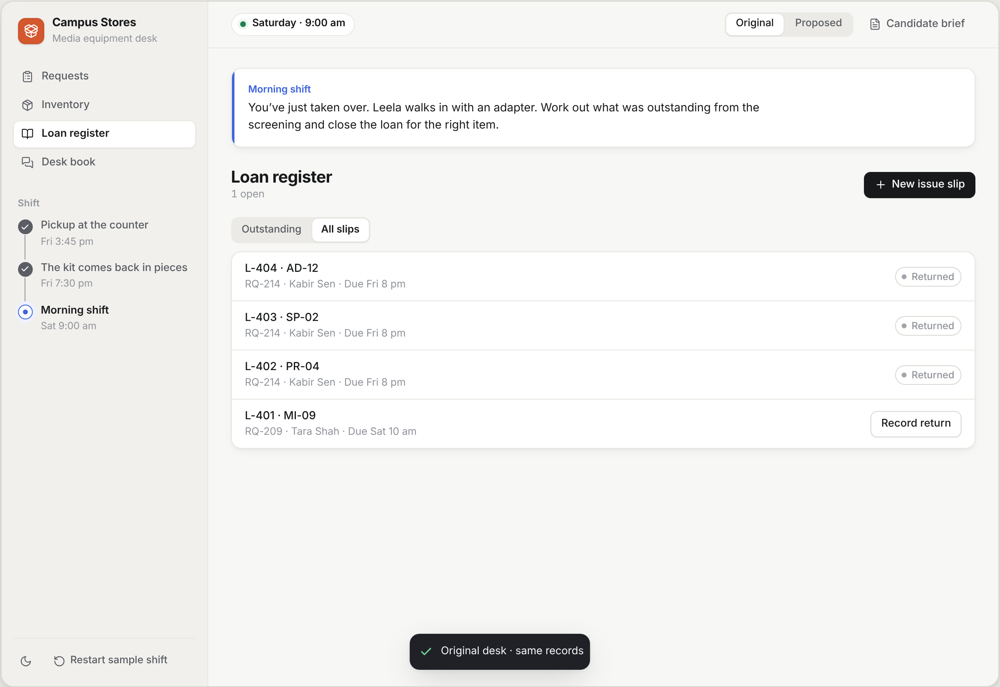
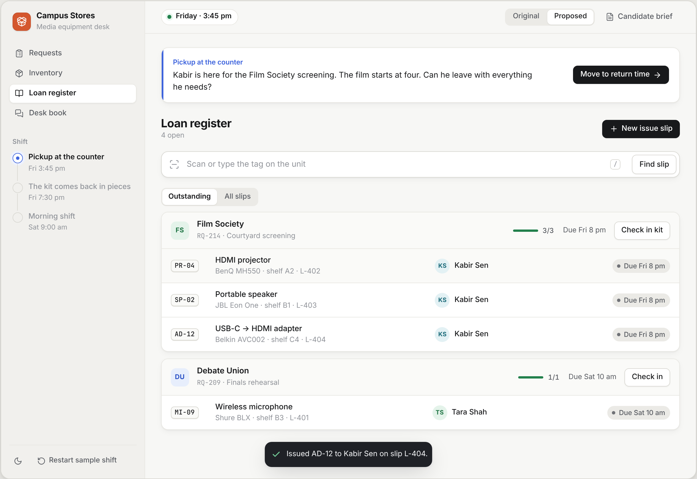
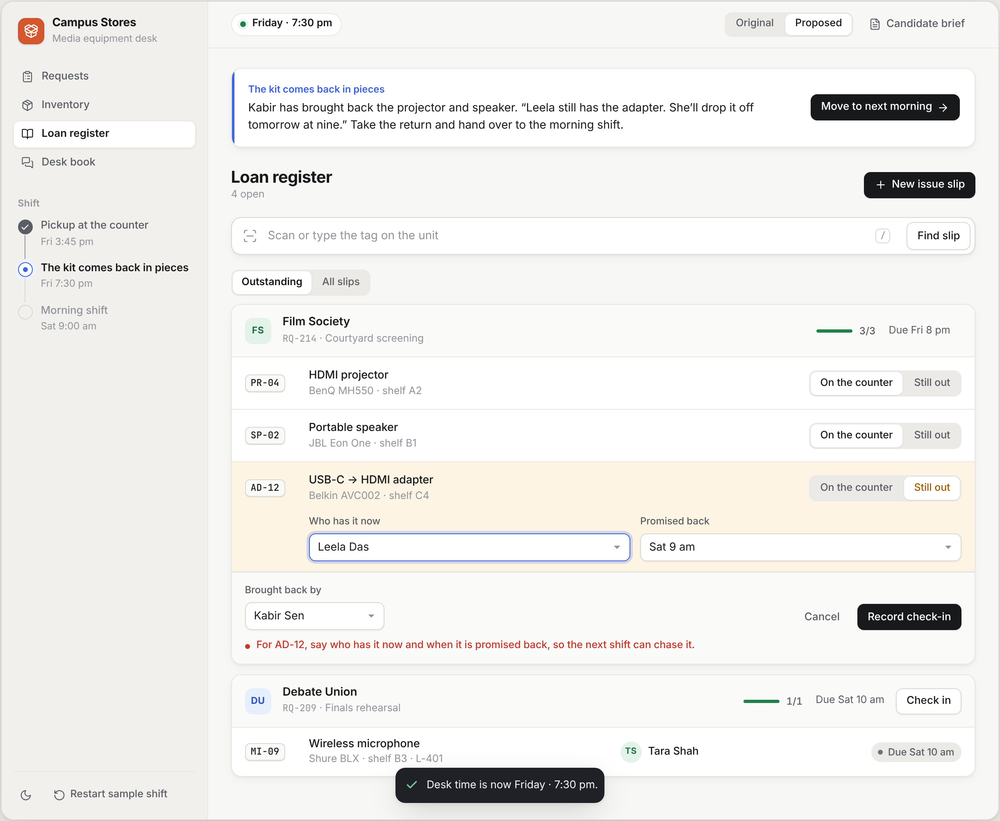
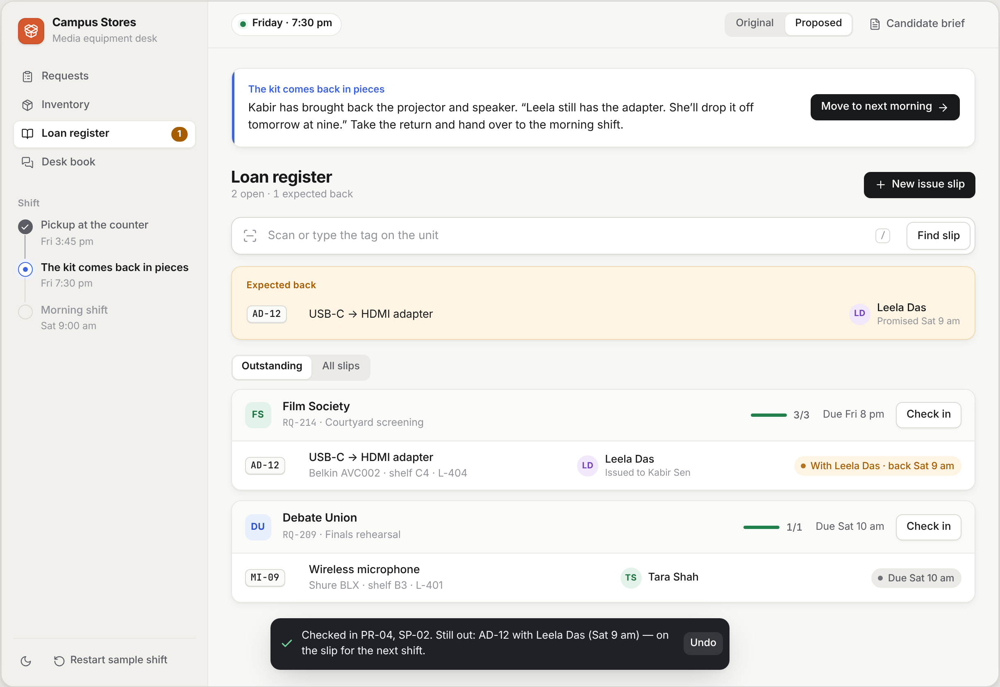
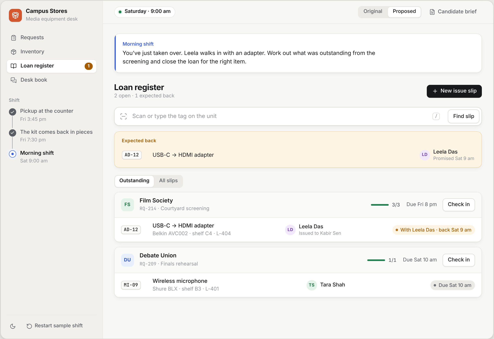
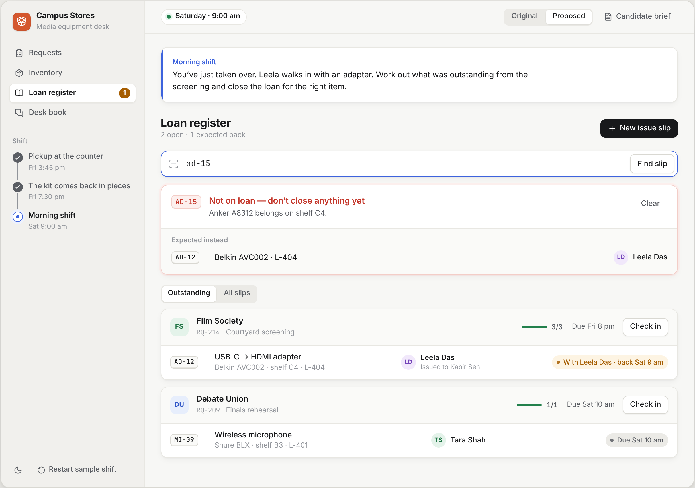
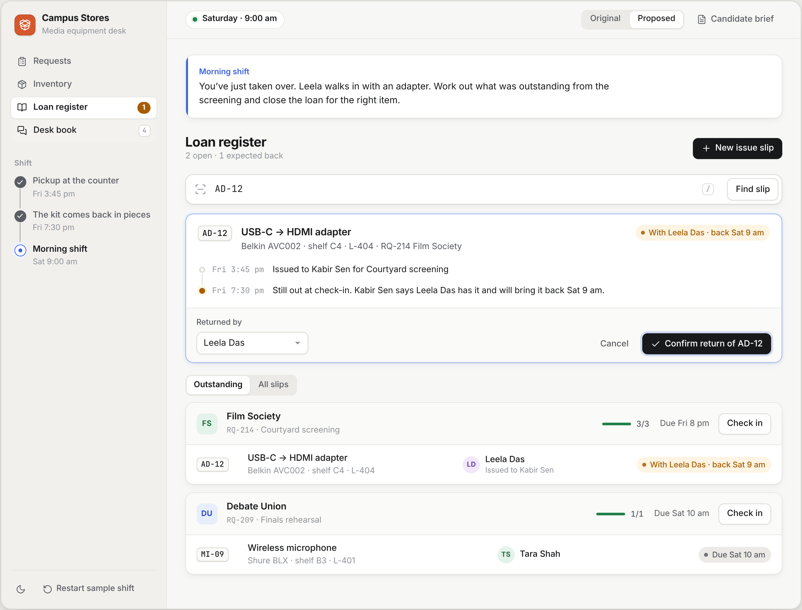
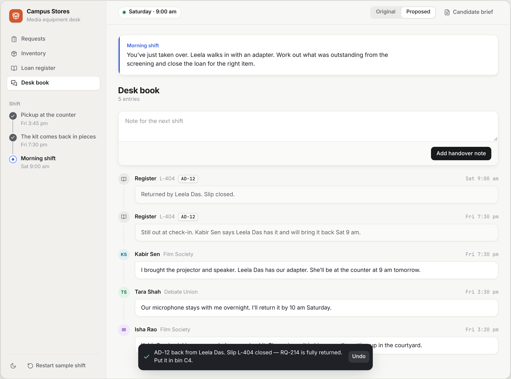
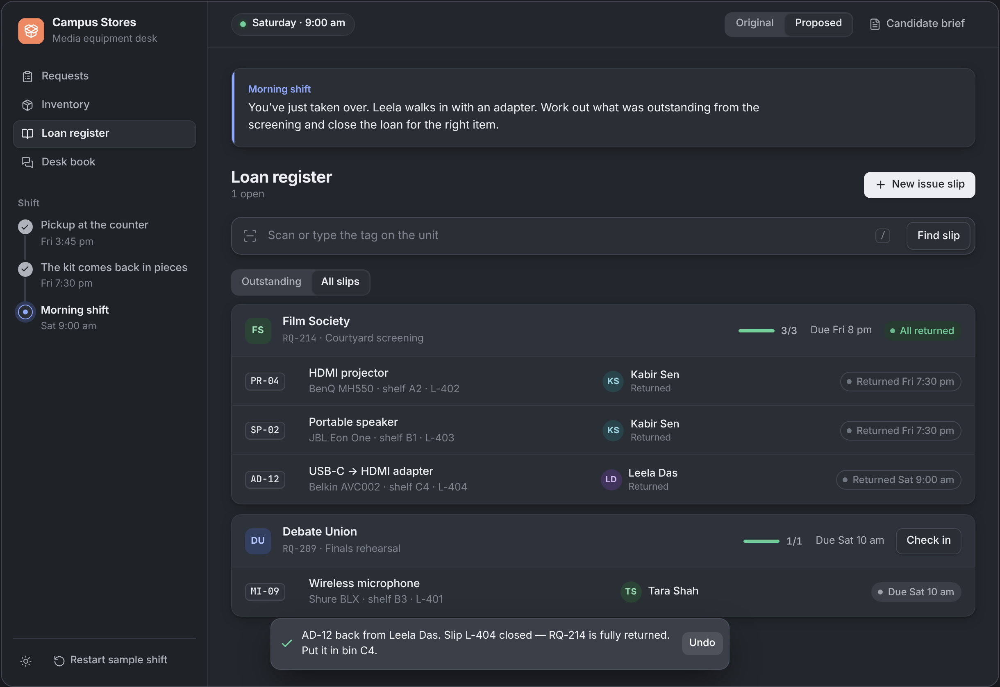
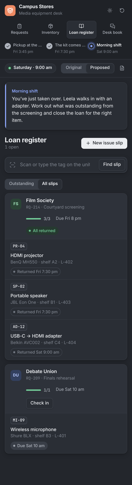

# Campus Stores

Campus Stores is a Product Engineer work sample set at a fictional campus media equipment desk. Work through a club’s screening, from equipment pickup to a partial return and the next morning’s handover. Open **Candidate brief** in the app for the assignment.

> **Reviewers: my submission is below, under [My work sample](#my-work-sample).**
> Open `index.html` and use the **Original desk / Proposed change** switch at the top to run the same shift both ways.

## Run the app

Open `index.html` in a modern browser. The app includes its scripts, styles, and icons and can run offline.

To serve it over local HTTP, run this from the repository folder and visit `http://localhost:8000`.

```sh
python3 -m http.server 8000 --bind 127.0.0.1
```

Each browser stores its own sample shift locally when browser storage is available. **Restart sample shift** restores the fictional starting records.

## Source

- `index.html` contains the desk layout, candidate brief, and bundled icons.
- `app.js` contains the sample records and interactions.
- `styles.css` defines the desktop and mobile layouts.
- `docs/` holds the screenshots used in this write-up.

Icon license notices are in [third-party/lucide-LICENSE.txt](third-party/lucide-LICENSE.txt).

---

## My work sample

**Would I keep this product? Yes.** Its record model is right, and I'd keep it as it is. What fails is the handover: a shift's knowledge ends up in a free-text diary instead of on the loan it's about.

### What the product handles well

**The moment:** Friday 3:45 pm. I issued PR-04 (projector), SP-02 (speaker) and AD-12 (adapter) to Kabir. I then tried to issue AD-15, a second adapter, against the same request. The desk refused: *"The approved quantity of this equipment type is already on loan."* It also never offers PR-06, which is in the workshop.

**Why it matters:** the desk enforces the approval itself instead of trusting the clerk to remember it. It also keeps **one slip per physical unit**. That one decision is what lets the kit come back in pieces at 7:30 pm without anything breaking: the projector and speaker slips close, and the adapter slip stays open. I built my change on top of this model and didn't replace it.

### The moment I would change

**The moment:** Saturday 9:00 am. I'm the new shift, and Leela walks in holding "an adapter". On the original desk, the Loan register shows two open slips with identical buttons:

```
L-404 · AD-12      RQ-214 · Kabir Sen · Due Fri 8 pm      [Record return]
L-401 · MI-09      RQ-209 · Tara Shah · Due Sat 10 am     [Record return]
```



What went wrong, step by step:

1. **The handover never reached the slip.** At 7:30 pm I knew three facts: AD-12 is still out, Leela has it, and it's coming back at 9 am. The only place to record them was a free-text note in the Desk book. In the morning, the slip still says *Kabir Sen · Due Fri 8 pm*. Both the person and the time are wrong, and nothing says it's overdue.
2. **The slip names a code, not a thing.** "AD-12" doesn't say adapter, Belkin, or bin C4. Leela is holding an object, so to match it I had to open Inventory in another tab. Two adapters, AD-12 (Belkin) and AD-15 (Anker), share bin C4, so "an adapter" isn't enough to know which slip to close.
3. **Closing a slip takes one click and checks nothing.** "Record return" doesn't ask which unit came back or who brought it, and it has no undo. While testing, I closed a slip just by clicking the first button in the list. The microphone slip sits right next to the adapter slip, also due Saturday morning.

The return at 7:30 pm has the same root cause. Kabir is returning a *kit*, but the desk makes me close it one unit at a time, with no way to say what didn't come back.

### My change: the loan carries its own handover

The original record model stays. I changed **where the shift's knowledge is written down** and **what you check before closing a slip**:

| | Original | Proposed |
|---|---|---|
| Kit comes back | Click "Record return" separately on each slip | **Check in kit**: mark each unit *On the counter* or *Still out* |
| Something is still out | Free-text note in the Desk book | The slip records **who has it now** and **when it's promised back** (both required) |
| Next shift opens the register | A list of codes | An **Expected back** list, a count badge in the nav, and slips grouped by request showing type, model and shelf |
| Someone walks in with a unit | Guess the slip, then click | **Unit at the counter**: type the tag on the item and the desk finds its slip and history |
| Wrong unit handed in | Nothing stops it | The desk says the unit isn't on loan and names the unit that is |
| Mistake | No way back | **Undo** right after every return |

The Desk book is now generated from the slips' own history, so the diary and the register can't disagree.

### Walking the same job with the change

**Friday 3:45 pm: pickup.** I issue the three units as before. The register groups them under *RQ-214 · Film Society · 3 of 3 approved items issued*, so "can Kabir leave with everything?" can be answered at a glance.



**Friday 7:30 pm: the kit comes back in pieces.** I press **Check in kit**. The projector and speaker are on the counter. I set the adapter to **Still out**, which asks *who has it now* (Leela Das) and *when it's promised back* (Sat 9 am). If I try to save without those two answers, the desk refuses, because without them the next shift can't follow up.



The confirmation reads: *Checked in PR-04, SP-02. Still out: AD-12 with Leela Das (Sat 9 am) — on the slip for the next shift.* That's the whole handover. I didn't write a separate note.



**Saturday 9:00 am: morning shift.** The register opens with **Expected back: AD-12 · USB-C → HDMI adapter · Leela Das · promised Sat 9 am.** I know what I'm waiting for before Leela reaches the counter.



I press `/` and read the tag on the adapter she's holding. If it says **AD-15**, the desk stops me: *Not on loan — don’t close anything yet. Anker A8312 belongs on shelf C4.* Below that, under *Expected instead*, it shows AD-12 (Belkin AVC002, L-404) with Leela Das. Without that, the original desk would have let me close the wrong unit, or the microphone slip.



When I type **AD-12**, the desk shows the slip and its history: issued to Kabir on Friday at 3:45 pm, and still out with Leela as of Friday at 7:30 pm. *Returned by* is already set to Leela. I confirm, and the confirmation reads *Slip L-404 closed — RQ-214 is fully returned. Put it in bin C4.* The microphone slip is untouched.



The Desk book now shows the chain of custody (issued, still out, returned by) next to the club messages.



It also works on a phone and in dark mode:

It has a light theme and a medium-dark theme (the moon icon in the sidebar), and it works on a phone:





### What I'd keep

- **One slip per physical unit.** This is the core of the product, and partial returns depend on it.
- **Checking issues against the approved request**, both the type and the quantity.
- **Units in repair never being offered.**
- **The Desk book**, for messages that aren't about a loan, such as Isha's authorization for Kabir.
- **The offline, no-build setup and the four-tab structure.** My change adds no new screen and no dependencies. I did rebuild the visual layer: a sidebar with the shift timeline, light and dim themes, asset tags styled like printed labels, initials for people, toasts with Undo, and the brief in a dialog. Both desks share it, so the comparison is about behaviour, not looks.

### The one observation at a real counter

> **When the morning clerk takes the unit from the student, do they read the tag before touching the screen, and do they close the slip without opening the Desk book or Inventory?**

If they read the tag first and close the slip from the register alone, the handover reached them through the slip, which is the whole point of the change. If they still flip to the Desk book, or pick the slip from the list without reading the tag, the change didn't help. Then the next thing to try is a printed or scannable tag, not more screens.

### What I deliberately didn't change

I saw other problems during the shift and chose not to fix them, to keep this to one argued change:
- The collector isn't checked against the club's authorization. I issued the Film Society projector to Dev Menon.
- *Return by* isn't defaulted from the request. I set "Sat noon" on a Fri 8 pm request.
- Issue-form errors appear as a passing notification instead of next to the field.
- **Restart sample shift** doesn't ask for confirmation.

A pickup checklist that issues a whole kit from its request would be my next change.

### Implementation notes

- Vanilla JS, no build step, still works offline. The **Original desk** mode runs the original screens unchanged, so reviewers can compare the two on the same records.
- The data model is extended, not replaced. Each loan gains `at`, `holder`, `expect`, `events[]`, `backAt` and `backBy`. Saved data uses a new storage key (`v2`) and is validated when it's restored.
- A failed check-in keeps the clerk's choices on screen. The error appears in place and focus moves to the missing field.
- The full shift was verified end to end in headless Chromium: pickup, check-in validation, undo, a wrong-tag lookup, a correct return, persistence across reload, original mode, and mobile width with no horizontal scroll. No console errors.

## Submit your work

1. [Fork Campus Stores](https://github.com/virinchi-healthcare/campus-stores/fork) into your GitHub account. Complete the candidate brief and push your changes to your public fork. In your README, point reviewers to your work and explain the decision you made.
2. In your fork, open **Commits**, select the final commit you want reviewed, and copy the page URL. It should look like `https://github.com/YOUR-USERNAME/campus-stores/commit/COMMIT-SHA`.
3. [Submit your work through the Google Form](https://docs.google.com/forms/d/e/1FAIpQLScvzoh1R4WS-SkiwAVBQbMvniieJYSoOEfLMyVo5CyjOvYUgQ/viewform). Your **roll number**, **email ID**, and **final commit link from your public fork** are required. Enter your roll number and email ID in the form only.
